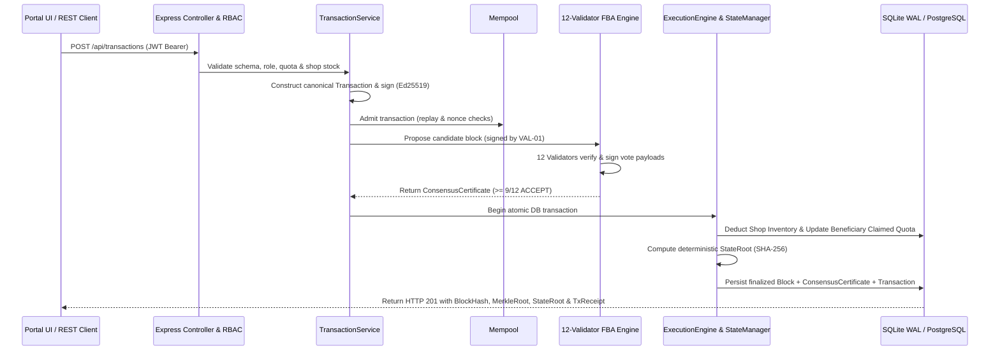

# PDSChain — System Architecture & Module Reference

## 1. Architectural Overview

**PDSChain** is a Blockchain-Based Public Distribution System designed to prevent ration diversion, quota falsification, and inventory tampering across state food supply chains. It implements a dual-layer cryptographic ledger architecture:

1. **Native PDS Blockchain & Consensus Layer** (`backend/src/blockchain/`, `backend/src/consensus/`, `backend/src/execution/`):
   - Canonical SHA-256 block headers (`version: 1`) and domain-separated Merkle trees (`0x00` leaf prefix, `0x01` internal node prefix).
   - Deterministic consensus state snapshots (`stateRoot`) covering beneficiaries, shops, warehouses, commodities, inventory balances, stock transfers, and embedded EVM state root.
   - Ed25519 digital signatures (RFC 8032 / Node `crypto`) for transaction authentication, block proposal signing, and validator voting.
   - 12-Validator Federated Byzantine Agreement (FBA) consensus engine enforcing a 9-of-12 (`>= 75%`) quorum threshold with signed `ConsensusCertificate` artifacts.
2. **Embedded Solidity / EVM Smart Contract Subsystem** (`contracts/`, `backend/src/blockchain/EVMRuntime.js`):
   - In-process `@ethereumjs/vm` (Cancun hardfork, Chain ID `1729`) executing 8 compiled Solidity `0.8.24` smart contracts (`PDSRegistry`, `PDSBeneficiaryRegistry`, `PDSFPSRegistry`, `PDSWarehouseRegistry`, `PDSInventoryManager`, `PDSEntitlementManager`, `PDSRationDistribution`, `PDSLedgerNotifier`).

---

## 2. Repository Directory Structure

```text
PDSChain/
├── backend/
│   ├── src/
│   │   ├── app.js                  # Express application, security headers, CORS, routes
│   │   ├── server.js               # Entry point, DB syncSafe, chain load, graceful shutdown
│   │   ├── blockchain/             # Block, Blockchain, Transaction, Merkle, EVMRuntime, Ed25519
│   │   ├── consensus/              # FBAConsensus, ValidatorNode, ConsensusCertificate
│   │   ├── execution/              # ExecutionEngine, StateManager,Mempool, Receipt
│   │   ├── controllers/            # REST API controllers (Auth, Beneficiary, Shop, Warehouse, Tx)
│   │   ├── services/               # Business & ledger services (transactionService, blockchainService)
│   │   ├── models/                 # Sequelize models (User, Beneficiary, Shop, Warehouse, Block, etc.)
│   │   ├── database/               # DatabaseManager, HA fencing, migration & sync guards
│   │   ├── network/                # P2P WireProtocol, SyncHandler, PeerManager
│   │   ├── rpc/                    # JSON-RPC 2.0 server (`pds_*` methods)
│   │   ├── security/               # RBAC PermissionRegistry, KeyStore, CertificateManager
│   │   ├── observability/          # Structured logger, secret redaction, Prometheus metrics, SLOs
│   │   ├── storage/                # StorageLayout, BackupManager (snapshots & verification)
│   │   ├── scripts/                # CLI provisioning tools (provisionAdmin.js, provisionIdentity.js, provisionValidators.js)
│   │   └── validators/             # 12-process validator supervisor (startValidators.js, validatorWorker.js, validatorServer.js)
│   └── tests/                      # 136 Jest test suites (1,140 tests)
├── contracts/
│   ├── contracts/                  # 8 Solidity 0.8.24 smart contracts
│   ├── scripts/deploy.js           # Hardhat deployment & wiring script
│   └── test/PDSContracts.test.js   # 20 Hardhat contract unit & workflow tests
├── frontend/
│   ├── html/                       # 37 HTML pages across 6 portals
│   ├── css/                        # Responsive stylesheet system
│   └── js/                         # 15 frontend modules (main.js, auth.js, api.js, explorer.js, etc.)
├── database/                       # Runtime SQLite WAL ledger, audit journals & 12 validator identities (VAL-01..VAL-12)
├── Dockerfile                      # Validator node container image
├── Dockerfile.app                  # Full-stack application container image
├── docker-compose.yml              # Single validator container deployment
├── docker-compose.network.yml      # 12-node multi-validator FBA network deployment (validator-01..validator-12)
└── docker-compose.production.yml   # Full-stack PostgreSQL + PDSChain + 12-validator production deployment
```

---

## 3. Six Role-Based Portals

1. **Administrator Portal** (`/html/admin/*.html`): Beneficiary lifecycle management, Fair Price Shop registry, warehouse oversight, anomaly alerts, and audit log review.
2. **Regional Warehouse Portal** (`/html/warehouse/*.html`): Bulk grain intake, silo capacity tracking, and cryptographically signed stock transfers (`STOCK_TRANSFER`) to Fair Price Shops.
3. **Fair Price Shop (FPS) Portal** (`/html/shop/*.html`): 6-step ration distribution pipeline (`DISTRIBUTION`), quota verification, and atomic stock deduction.
4. **Citizen / Beneficiary Portal** (`/html/citizen/*.html`): Personal ration entitlement display, claim history, and on-chain transaction receipt verification.
5. **Validator Telemetry Portal** (`/html/validator/*.html`): Interactive 12-validator (`V1..V12` / `VAL-01..VAL-12`) proposal & authenticated step-by-step voting console, 3-of-4 FBA quorum slice monitor, 4-stage consensus telemetry, OS process PID/Port health, and node failure/recovery simulator.
6. **Blockchain Explorer** (`/html/explorer.html`, `/html/blockchain.html`): Public block/transaction/event explorer, pending/unfinalized vs finalized block certificate inspector, Merkle proof verifier, and interactive EVM smart contract inspector.

---

## 4. End-to-End Transaction Lifecycle



